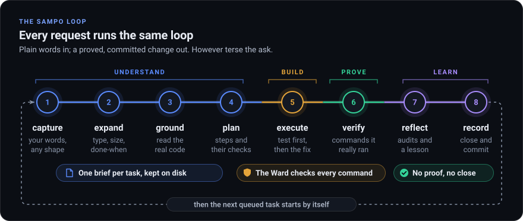
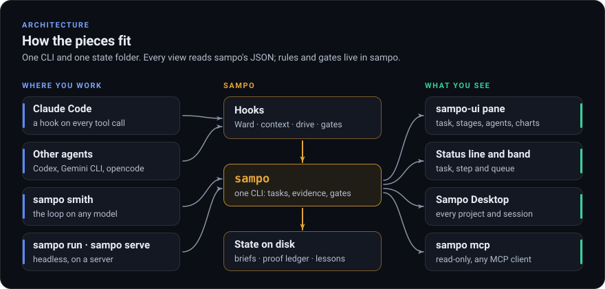
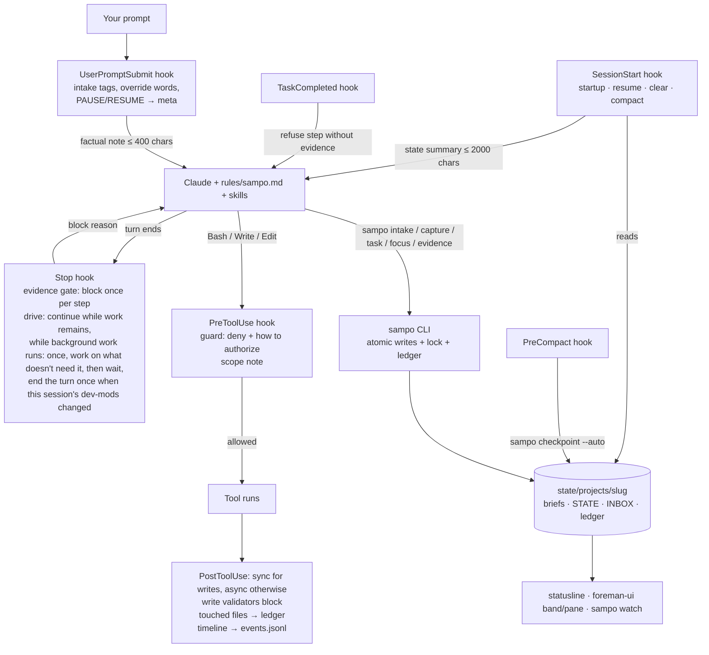

# Sampo — system map

Not loaded every session (`~/.claude/rules/foreman.md` points here). Read it when you're unsure where something lives or how the parts interact. `sampo doctor` checks the file map below against disk.

**Names:** Sampo (formerly Foreman) is the product; its parts are Smith (the task loop: plan, build, prove), Rune (Genesis, `sampo rune`), Moons (moonshots), Louhi (the exam, `sampo louhi`), Underworld (the not-yet ledger) and the Ward (the guard). Several Rune towers can share a project: `sampo genesis --tower NAME <verb>` works on `research/genesis/towers/NAME` (own gen-0, docs, steers.md, exam lines); moons, exam scenarios and the user's steers stay shared at the root; `sampo genesis towers` lists them; publish, export and live stay root-only (T-3053). The old names stay as aliases, and every path, command and plugin id below keeps its old spelling. Environment variables are named `SAMPO_*`; the old `FOREMAN_*` names still work.

**Contents:** [What it is](#1-what-sampo-is) · [Prompting](#2-how-to-prompt-it) · [File map](#3-file-map) · [Interaction diagram](#4-interaction-diagram) · [Lifecycle](#5-lifecycle-walkthrough-a-fix-line-to-an-archived-task) · [Precedence](#6-source-of-truth-and-precedence) · [Integrations](#7-integrations) · [BUILD_PROMPT](#8-relationship-to-build_promptmd-and-the-repo) · [Operations](#9-operations) · [Limitations](#10-known-limitations) · [Deviations](#11-deviations-from-build_promptmd)

## 1. What Sampo is

Sampo is a local discipline layer for coding agents: a small state CLI `sampo` and one hook dispatcher, packaged as a Claude Code plugin (hooks, skills, always-on rules, read-only agents) and wired into Codex, Gemini CLI (legacy: Code Assist Enterprise/API keys; individuals moved to Antigravity `agy`) and opencode by `sampo agents install`, with `sampo smith` running the same loop on any model. It runs every request, however terse, through one loop:

**capture → expand → ground → plan → execute → verify → reflect → record**

It keeps one central, current record per project (what's active, what's queued, what was decided, what was learned), refuses "done" without recorded evidence, captures new ideas instead of chasing them, resumes at the exact step after `/compact`, `/clear` or a new session, blocks dangerous commands in bypass mode, audits finished work through independent lenses before it counts as done, asks for consent in plain chat (never by making you run a command), brainstorms open-ended requests, and keeps working through the queue ("drive", optionally in full autonomy) until it's empty or it needs you. It's cheap: ~62 always-on instruction lines and ~1.3k tokens of skill/agent descriptions; hooks run at p50 ≈ 29 ms, p95 ≤ 33 ms (no `traceback` or `dataclasses` on the hook path: `fmcore.record` stands in for `@dataclass`, tracebacks load only on errors; `tests/test_core.py` keeps it that way).

## 2. How to prompt it

The full text is in [docs/map/guide-1.md](docs/map/guide-1.md) (T-4562): the prompt forms and tags, override words, plain words, slash commands, CLI verbs and the harness's procedure.

## 3. File map

By area; each table folds. Columns: path, purpose, owner, when it loads, budget.

Each entry below is one index line: the first words of its full entry and a link to the docs/map shard that holds it whole (module bullets sorted by name). Add a new entry's full text to its shard and one index line here.

### Top level

The repo root: the specs, the installers and the marketplace.

- `BUILD_PROMPT.md` origin spec [→ files-1](docs/map/files-1.md)
- `MASTER.md` this map [→ files-1](docs/map/files-1.md)
- `README.md` repo overview, install [→ files-1](docs/map/files-1.md)
- `CHANGELOG.md` per-version changes [→ files-1](docs/map/files-1.md)
- `install.sh` one-line bootstrap: clone, plugins, marketplace + plugin, bypass… [→ files-1](docs/map/files-1.md)
- `setup-plugins.sh` curated plugin setup, `--dry-run` [→ files-1](docs/map/files-1.md)
- `configure-repo.sh` point install at a GitHub repo (one-time) [→ files-1](docs/map/files-1.md)
- `reset-claude.sh` optional behavior-layer reset before installing [→ files-1](docs/map/files-1.md)
- `.claude-plugin/marketplace.json` local marketplace `sampo` → `./plugin` [→ files-1](docs/map/files-1.md)
- `scripts/probe-plugin-rename.sh` how a plugin rename moves an install, in a scratch Claude config (T-2879) [→ files-1](docs/map/files-1.md)

### plugin/

The plugin itself: CLI, hooks, rules, skills, agents, tests.

- `plugin/.claude-plugin/plugin.json` plugin manifest (name, version) [→ files-1](docs/map/files-1.md)
- `plugin/settings.json` plugin default `subagentStatusLine` [→ files-1](docs/map/files-1.md)
- `plugin/bin/fm` CLI entry (on the Bash tool PATH; protected) [→ files-1](docs/map/files-1.md)
- `plugin/lib/` the Python modules, one line each under "plugin/lib modules"… [→ files-1](docs/map/files-1.md)
- `plugin/hooks/hooks.json` one handler per event (13 events), exec form… [→ files-1](docs/map/files-1.md)
- `plugin/defaults.json` every setting's default as the last release shipped it… [→ files-1](docs/map/files-1.md)
- `plugin/protocols.json` how much deliberation each tier gets: S no panel, M a… [→ files-1](docs/map/files-1.md)
- `plugin/hooks/hook` dispatcher `hook <Event>`, and… [→ files-1](docs/map/files-1.md)
- `plugin/hooks/fast` PreToolUse entry (T-3571): runs `plugin/native/sampo-fast`… [→ files-1](docs/map/files-1.md)
- `plugin/hooks/wait-timer` second Stop hook (T-4525, `asyncRewake`): reads the background jobs the Stop hook… [→ files-1](docs/map/files-1.md)
- `plugin/native/` Rust workspace of `sampo-fast` (T-3571), the native… [→ files-1](docs/map/files-1.md)
- `plugin/integrations/opencode/foreman.ts` opencode plugin… [→ files-1](docs/map/files-1.md)
- `plugin/hooks/statusline` statusLine: one true-color session line + Sampo line… [→ files-1](docs/map/files-1.md)
- `plugin/monitors/monitors.json` plugin monitor `foreman-mail`… [→ files-1](docs/map/files-1.md)
- `plugin/hooks/subagent-statusline` per-subagent rows (task, tokens vs window… [→ files-1](docs/map/files-1.md)
- `plugin/rules/sampo.md` always-on operating rules (protected; reached from… [→ files-1](docs/map/files-1.md)
- `plugin/rules/foreman.md` symlink to `sampo.md`, kept so the user's… [→ files-1](docs/map/files-1.md)
- `plugin/output-styles/foreman.md` the Sampo reply format (task/stage header… [→ files-1](docs/map/files-1.md)
- `plugin/skills/` intake (+ references: planning, execute, audit lenses… [→ files-1](docs/map/files-1.md)
- `plugin/agents/` (T-0768: `effort`, `maxTurns`, and `omitClaudeMd` on the… [→ files-1](docs/map/files-1.md)
- `plugin/commands/build.md` `/sampo:build` (the bootstrap) [→ files-1](docs/map/files-1.md)
- `plugin/commands/backlog.md` `/sampo:backlog` (T-1664: `sampo inbox first`… [→ files-1](docs/map/files-1.md)
- `plugin/workflows/` `/sampo:review` and `/sampo:ideas` multi-agent… [→ files-1](docs/map/files-1.md)
- `plugin/templates/` `brief.md` template; `mcp-server/` (sampo mcp new)… [→ files-1](docs/map/files-1.md)
- `plugin/themes/` optional Sampo color theme (`/theme`) [→ files-1](docs/map/files-1.md)
- `plugin/web/` `live/`: the page `sampo watch --web` serves (T-2999)… [→ files-1](docs/map/files-1.md)
- `plugin/observability/` telegraf OTel input, Grafana dashboard, setup notes [→ files-1](docs/map/files-1.md)
- `plugin/evals/` `claude plugin eval` cases with the rules embedded (protected) [→ files-1](docs/map/files-1.md)
- `plugin/tests/` unit/behaviour tests, fixtures, hook bench, `e2e/` (live… [→ files-1](docs/map/files-1.md)
- `plugin/uninstall.sh` remove wiring, plugin and marketplace; keeps state unless… [→ files-1](docs/map/files-1.md)
- `plugin/README.md` plugin overview [→ files-1](docs/map/files-1.md)
- `plugin/THIRD_PARTY_LICENSES.md` MIT licenses of ported ECC and superpowers… [→ files-1](docs/map/files-1.md)

### plugin/lib modules

One line per module, so two changes to different modules never touch the same line (T-1713).

- 3D checks offline (T-1530, `fmscene`): an animation may target `camera`… [→ files-lib-1](docs/map/files-lib-1.md)
- `fmtidy._prune_exam_work` (T-2568: `sampo tidy --apply` removes… [→ files-lib-1](docs/map/files-lib-1.md)
- `sampo log NAME [DATA]` (T-2244): a session's note, recorded as event `log`… [→ files-lib-1](docs/map/files-lib-1.md)
- `sampo prove --docs [FILE...]` (T-2381, `fmprove.docs_proof` over… [→ files-lib-1](docs/map/files-lib-1.md)
- `sampo prove --rollup [--days N] [--json]` (`fmcore.unproven`, T-2273, T-2391… [→ files-lib-1](docs/map/files-lib-1.md)
- `fmregen` (T-2918, M-02 slice: `sampo moons regen PATH [--model P]` (also… [→ files-lib-1](docs/map/files-lib-1.md)
- Build what's missing (T-2278): `sampo new tool NAME [DIR]` (`fmnew._scaffold`… [→ files-lib-1](docs/map/files-lib-1.md)
- Capability miss (T-2270): the PostToolUseFailure hook (main thread only) reads… [→ files-lib-1](docs/map/files-lib-1.md)
- Design sprint (T-1538, `fmdesign`): `sampo design sprint [ROOT]` (`sprint`… [→ files-lib-1](docs/map/files-lib-1.md)
- Divergence (T-1536, `fmtaste`)… [→ files-lib-1](docs/map/files-lib-1.md)
- fmmodels profile keys for local generation (T-2893): `body` (an object merged… [→ files-lib-1](docs/map/files-lib-1.md)
- Learning from playbooks (T-1525, `fmplaybooks`)… [→ files-lib-1](docs/map/files-lib-1.md)
- Literacy and prompt variants (T-1403): `sampo smith runners --probe MODEL`… [→ files-lib-1](docs/map/files-lib-1.md)
- Offers (T-1397): `sampo smith` prints one… [→ files-lib-1](docs/map/files-lib-1.md)
- Playbooks from this repo's own work (T-1523, `fmplaybooks`)… [→ files-lib-1](docs/map/files-lib-1.md)
- Plugin parity (T-1822, memory cc-plugin-parity): `tests/test_plugin_parity.py`… [→ files-lib-1](docs/map/files-lib-1.md)
- Receipts and review (T-1547, `fmcli`): `sampo task receipt ID --svg FILE`… [→ files-lib-1](docs/map/files-lib-1.md)
- sampo smith app extras (T-1546, `fmcodetui`): F (`photo`, `App.take_photo`; the… [→ files-lib-1](docs/map/files-lib-1.md)
- Scaffolding and dev loop (T-1554): `sampo new NAME DIR` into a folder that… [→ files-lib-1](docs/map/files-lib-1.md)
- Session and release care (T-1549): `fmideas.user_voice` keeps each quote once… [→ files-lib-1](docs/map/files-lib-1.md)
- Shader sketchbook (T-1784, `fmscene`): each shader look card has a `## Sketch`… [→ files-lib-1](docs/map/files-lib-1.md)
- Site build and stories (T-1541): `fmcodetui.snapshot` draws at t=0, so… [→ files-lib-1](docs/map/files-lib-1.md)
- T-2782: modules renamed into the sampo package (T-2742) keep their entries… [→ files-lib-1](docs/map/files-lib-1.md)
- Taste follow-ups (T-1672, `fmtaste`): `sampo looks roll` draws the look of the… [→ files-lib-1](docs/map/files-lib-1.md)
- Upstream watch (T-1391, `fmscout`): a stale skill source whose remote HEAD… [→ files-lib-1](docs/map/files-lib-1.md)
- `fmagents` (`sampo agents list|install|uninstall codex|gemini|opencode`: `list`… [→ files-lib-1](docs/map/files-lib-1.md)
- `fmahead` (T-4662, foresight part A of T-4185: `sampo ahead [--tick] [--json]`, `sampo/ahead.py`. A local model… [→ files-lib-1](docs/map/files-lib-1.md)
- `fmambient` (`sampo check ambient on`: the affected tests run detached after… [→ files-lib-1](docs/map/files-lib-1.md)
- `fmanergy` (T-2563, gen-2 moonshot: anergy for permission prompts [→ files-lib-1](docs/map/files-lib-1.md)
- `fmobjections` (T-3276: `sampo audit ahead ID` ranks ledger `finding` events (rejected and this task's left out… [→ files-lib-1](docs/map/files-lib-1.md)
- `fmauditrun` (T-1186: `sampo audit run ID`, the audit lenses as headless… [→ files-lib-1](docs/map/files-lib-1.md)
- `fmaway` (T-1155: `sampo away`, the summary on return after a long gap) [→ files-lib-1](docs/map/files-lib-1.md)
- `fmbacktest` (T-1058: `sampo backtest`, where a changed rule, known fix or card… [→ files-lib-1](docs/map/files-lib-1.md)
- `fmbench`… [→ files-lib-1](docs/map/files-lib-1.md)
- `fmboard` (T-3659: the live page's Board, fourteen panels from the snapshot… [→ files-lib-1](docs/map/files-lib-1.md)
- `fmbudget` (`sampo budget`: one spend ledger for child runs and subagents, caps… [→ files-lib-1](docs/map/files-lib-1.md)
- `fmbus` (`sampo bus`, `sampo lease`, `sampo conductor`: messages between… [→ files-lib-1](docs/map/files-lib-1.md)
- `fmclaims` (T-3321, Fleet part 1: `Claims(root).take/renew/release/list` keep claims as the refs… [→ files-lib-1](docs/map/files-lib-1.md)
- `fmfleet` (T-3330, Fleet part 2: focus takes a task's claim; the edit hook refuses once another machine holds it… [→ files-lib-1](docs/map/files-lib-1.md)
- `fmchange` (`sampo spec "<wish>" --module M`: a one-line wish as a red unittest… [→ files-lib-1](docs/map/files-lib-1.md)
- `fmci` (T-1052: `sampo ci-watch`, the branch's latest GitHub Actions run polled… [→ files-lib-1](docs/map/files-lib-1.md)
- `fmclaude` (`sampo claude`: every Claude Code session on the device from its… [→ files-lib-1](docs/map/files-lib-1.md)
- `fmcli` [→ files-lib-1](docs/map/files-lib-1.md)
- `fmcode` (T-1212: `sampo smith`, Sampo's loop run by the harness on any… [→ files-lib-1](docs/map/files-lib-1.md)
- `fmcodebench` (T-1215: `sampo smith bench`, a model or worker CLI graded as a… [→ files-lib-1](docs/map/files-lib-1.md)
- `fmcodeboard` (T-3699, `sampo/smithboard`: the live page's Board in `sampo smith tui`… [→ files-lib-1](docs/map/files-lib-1.md)
- `fmbenchtb` (T-3747: `sampo bench tbench --model P [--n 20] [--category C] [--only IDS] [--tasks DIR]`… [→ files-lib-1](docs/map/files-lib-1.md)
- `fmcodemod`… [→ files-lib-1](docs/map/files-lib-1.md)
- `fmcodeterm` (T-1300: the terminal under `sampo smith tui` without curses: ANSI… [→ files-lib-1](docs/map/files-lib-1.md)
- `fmcodetui` (T-1283: `sampo smith tui`, sampo smith's terminal UI, drawn only… [→ files-lib-1](docs/map/files-lib-1.md)
- `fmcontract` (T-1158: `sampo contract`, how long and how much an unattended run… [→ files-lib-1](docs/map/files-lib-1.md)
- `fmcore` (state, briefs, queue, intake, ledger, locks, audits; T-2015… [→ files-lib-5](docs/map/files-lib-5.md)
- `fmcost` (`sampo burden`: Sampo's own cost per session and version from the… [→ files-lib-5](docs/map/files-lib-5.md)
- `fmcpu` (T-3592: `sampo cpu`, this session's CPU from its cgroup by kind; the 10% goal self-check… [→ files-lib-5](docs/map/files-lib-5.md)
- `fmcritique` (T-1642: `sampo critique URL|FILE`, a computed-style census of the… [→ files-lib-5](docs/map/files-lib-5.md)
- `fmdataproof`… [→ files-lib-5](docs/map/files-lib-5.md)
- `fmdebug` (`sampo whyred --suspects`, `sampo whyred`, `sampo record`: a red… [→ files-lib-5](docs/map/files-lib-5.md)
- `fmdemo` (`sampo demo`: the real sampo CLI and guard fix a seeded bug in a… [→ files-lib-5](docs/map/files-lib-5.md)
- `fmdeps` (T-1049: a package new to the project in an npm/pip/cargo install gets… [→ files-lib-5](docs/map/files-lib-5.md)
- `fmdesign` (T-1645: `sampo design check [ROOT]` runs the gates DESIGN.md's… [→ files-lib-5](docs/map/files-lib-5.md)
- `fmdocs` (`sampo docs`: doc drift against the code) [→ files-lib-5](docs/map/files-lib-5.md)
- `fmdoctrace` (T-3287, `sampo docs --trace [--since REF]`, `sampo.doctrace`): each `docs.claims` row with the doc… [→ files-lib-5](docs/map/files-lib-5.md)
- `fmdoctor` (T-2398: proof worlds: each fm-run evidence line carries [world H]… [→ files-lib-5](docs/map/files-lib-5.md)
- `fmdojo` (T-1608: `sampo dojo [--rounds N] [--seed S] [--quiz]`, a drill for… [→ files-lib-5](docs/map/files-lib-5.md)
- `fmdoors` (T-2342, Mission 5 #8; T-2424: _ambiguous also reads rival_split, so… [→ files-lib-5](docs/map/files-lib-5.md)
- `fmdraft` (T-1062: `sampo draft`, a headless claude drafts the top queued S… [→ files-lib-5](docs/map/files-lib-5.md)
- `fmdrill` (T-1669: `sampo drill [--seed N] [--faults 3-7]`), a scripted day… [→ files-lib-5](docs/map/files-lib-5.md)
- `fmspar` (T-3281: `sampo spar`), the nightly hook fuzz: mutated payloads through every hook… [→ files-lib-5](docs/map/files-lib-5.md)
- `fmeco` (`sampo projects --sweep`, `sampo adopt`, `sampo inbox gh`… [→ files-lib-5](docs/map/files-lib-5.md)
- `fmedit` (T-1089: `sampo edit` and `sampo sub`, many exact replacements in one… [→ files-lib-5](docs/map/files-lib-5.md)
- `fmeditverdict` (T-3277, Moon C-001115: `sampo/editverdict.py`; `sampo check ambient edits [--json]` lists the last… [→ files-lib-5](docs/map/files-lib-5.md)
- `fmevolve` (`sampo evolve`: one bench-gated generation revising or ablating one… [→ files-lib-5](docs/map/files-lib-5.md)
- `fmexam` (T-2524: kind package, #10 beside beyond, Python only (PY_ONLY: draw… [→ files-lib-1](docs/map/files-lib-1.md)
- `fmextras`… [→ files-lib-2](docs/map/files-lib-2.md)
- `fmfastbuild` (T-3608: `python3 -I plugin/lib/sampo/fastbuild.py [--status]`, `sampo doctor --repair|--fix`; the… [→ files-lib-2](docs/map/files-lib-2.md)
- `fmflake_forecast` (`sampo flakes [--red NAME …] [--top N] [--json]`, T-3286: forecasts which tests will likely… [→ files-lib-2](docs/map/files-lib-2.md)
- `fmfind` (`sampo find [PATH] [--rank] [--capture N] [--json]`, T-2121… [→ files-lib-2](docs/map/files-lib-2.md)
- `fmfits` (T-3499: situation probes: an unused verb or skill whose moment is now, with its numbers… [→ files-lib-2](docs/map/files-lib-2.md)
- `fmfixes` (T-1032: known fixes, `sampo fix list|add|rm`: a failed Bash command… [→ files-lib-2](docs/map/files-lib-2.md)
- `fmflow` (T-1639: `sampo flow FILE`, a journey of goto/click/type/expect/wait… [→ files-lib-2](docs/map/files-lib-2.md)
- `fmflowreport` (T-5503: the Flow section and `flow` key of `sampo digest`, request-to-done by stage, agents, tests, guard… [→ ops-3](docs/map/ops-3.md)
- `fmfoldpage` (T-5020: `sampo fold set ID VERDICT [--to ID] [--evidence path:line] [--why T]`, `fold pa… [→ files-lib-2](docs/map/files-lib-2.md)
- `fmforesight` (T-2554: `_requests(p, clean=True)` leaves out briefs a Genesis… [→ files-lib-2](docs/map/files-lib-2.md)
- `fmfriction` (`sampo friction`: the self-improvement digest and trigger… [→ files-lib-2](docs/map/files-lib-2.md)
- `fmfuncreview` (T-4388: `sampo smith`'s function-by-function review before a plan for the code as a whole… [→ files-lib-2](docs/map/files-lib-2.md)
- `fmgenesis`… [→ files-lib-7](docs/map/files-lib-7.md)
- `fmkickoff` (`sampo kickoff ID [--json]`, T-3291: a task's plan dry-run before its first edit, from the brief… [→ files-lib-2](docs/map/files-lib-2.md)
- `fmkalevala_giant` (T-5014, T-4337's slice: a Kalevala generation as a GIANT task, one XL milestone per tower… [→ files-lib-2](docs/map/files-lib-2.md)
- `fmtargets` (T-5709, `sampo targets [--json]`, the shim for `sampo.targets`): the outcome targets in… [→ files-lib-8](docs/map/files-lib-8.md)
- `fmkalevala_levels` (T-5013: the shim for `sampo.kalevala_levels`, one generic level type… [→ files-lib-2](docs/map/files-lib-2.md)
- `fmkalevala_landed` (T-5025: `sampo/kalevala_landed.py`, what `kalevala select` records of a gen's GIANT task: each… [→ files-lib-2](docs/map/files-lib-2.md)
- `fmgrants` (T-2374: the install-grant queue [→ files-lib-7](docs/map/files-lib-7.md)
- `fmgraph` (`sampo graph blast|pack|build`: one local sqlite graph of code… [→ files-lib-7](docs/map/files-lib-7.md)
- `fmgatemap` (`sampo gatemap [FILES] [--json]`, T-3278, the shim for `sampo.gatemap`): `learn(p)` reads the ledger's… [→ files-lib-2](docs/map/files-lib-2.md)
- `fmkalevala` (`sampo kalevala [start|status|step [--dry-run] [--k N]]`, T-3081, the shim for `sampo.kalevala`)… [→ files-lib-2](docs/map/files-lib-2.md)
- `fmbisecthunk` (`sampo bisect --hunks`, T-3269, the shim for `sampo.bisecthunk`)… [→ files-lib-2](docs/map/files-lib-2.md)
- `fmguard` [→ files-lib-2](docs/map/files-lib-2.md)
- `fmhome` (T-1665: `sampo home export [--out FILE]` / `sampo home import FILE`… [→ files-lib-2](docs/map/files-lib-2.md)
- `fmmovemod` (T-3274: `sampo move OLD NEW`), renames a module and rewrites every reference… [→ files-lib-1](docs/map/files-lib-1.md)
- `fmseams` (T-3290: `sampo seams FILE`), the cleanest split clusters of a big module… [→ files-lib-1](docs/map/files-lib-1.md)
- `fmlouhi_scratch` (T-3290: `_scratch` and `_gen_grow` moved out of louhi.py, which re-exports them) [→ files-lib-1](docs/map/files-lib-1.md)
- `fmhomemove` (T-2746: `sampo migrate [--undo] [--dry-run] [--json]`) renames… [→ files-lib-2](docs/map/files-lib-2.md)
- `fmhooks` (incl [→ files-lib-2](docs/map/files-lib-2.md)
- `fmhooksmoke` (T-5040: `run(plugin=None)` returns `(ok, why)` after feeding a tree's own hooks/hook SessionStart… [→ files-lib-2](docs/map/files-lib-2.md)
- `fmideas` (tool-less brainstorm children with a coverage map and holes per… [→ files-lib-2](docs/map/files-lib-2.md)
- `fmimg` (T-1630: `sampo img info|diff`, a stdlib PNG codec, 8-bit and below… [→ files-lib-2](docs/map/files-lib-2.md)
- `fmincident` (T-2388: `sampo capture --incident '<impact>' --signal CMD` runs… [→ files-lib-2](docs/map/files-lib-2.md)
- `fminfra` (`sampo prove --infra [PATH] [--yes-run] [--json]`, T-2385: each… [→ files-lib-2](docs/map/files-lib-2.md)
- `fminstr` (`sampo which --instruments`: the zero-token instruments `sampo sym`… [→ files-lib-2](docs/map/files-lib-2.md)
- `fmintegrations` (T-1551: Sampo for other tools, read-only: `sampo timeline` as… [→ files-lib-2](docs/map/files-lib-2.md)
- `fmjeffexport` (T-2970: Sampo's own decider on Jeff, `sampo exam models --jeff DIR` and `--train-jeff`: Examples… [→ files-lib-2](docs/map/files-lib-2.md)
- `fmpilotsig` (T-5708: a sampo:fm-builder's return starts one detached lane pilot per lane (`sampo lane pilot ID… [→ files-lib-8](docs/map/files-lib-8.md)
- `fmjobprog` (T-5034: the live page's background job rows with elapsed, typical, ratio, last log line and an ended… [→ files-lib-2](docs/map/files-lib-2.md)
- `fmlake` (T-2974: the training lake, `sampo exam models --export DIR [--with-agent]`: outcome-labelled… [→ files-lib-2](docs/map/files-lib-2.md)
- `fmrecover` (T-3928, `sampo/recover.py`): a restart nobody announced. `cli.main` wraps `lane land`, `lane train`… [→ files-lib-2](docs/map/files-lib-2.md)
- `fmjobsreg` (T-5031, `sampo.jobsreg`: `sampo jobs add NAME --why WHY` registers a job started by hand in the… [→ files-lib-2](docs/map/files-lib-2.md)
- `fmpulse` (T-5591, `sampo.pulse`): `sampo pulse [--wait N]` is one read-only screen: load and free disk, the… [→ files-lib-8](docs/map/files-lib-8.md)
- `fmlandlock` (T-1607: a sampo smith worker's writes confined with Landlock… [→ files-lib-2](docs/map/files-lib-2.md)
- `fmmacros` (T-3922, `sampo.macros`): `sampo do NAME` runs a routine from `plugin/macros/*.json` (1 to 3 verb steps… [→ files-lib-3](docs/map/files-lib-3.md)
- `fmlane_overlap` (T-3285, `sampo/lane_overlap.py`): `scan()` gives `sampo lane list` one `OVERLAP A and B:` line per… [→ files-lib-2](docs/map/files-lib-2.md)
- `fmlanes` (`sampo lane`: git worktrees as lanes with their own active task; T-2368: `sampo lane stats` [--json] is… [→ files-lib-2](docs/map/files-lib-2.md)
- `lane land` ship (T-4239: the land never waits for a ship: after a train it starts one detached niced… [→ files-lib-6](docs/map/files-lib-6.md)
- `fmlane_preview` (`sampo lane list`: a trial merge of each open lane branch against main and each other names the… [→ files-lib-2](docs/map/files-lib-2.md)
- `fmledger` (`sampo verify-ledger`: the ledger's hash chain proved line by line… [→ files-lib-2](docs/map/files-lib-2.md)
- `fmlib` (T-0933: `sampo lib` — the stack library: card parsing and lint, stack… [→ files-lib-2](docs/map/files-lib-2.md)
- `fmlong`… [→ files-lib-2](docs/map/files-lib-2.md)
- `fmlive` (T-2998: `sampo watch --web [--url|--port N]`, a read-only page on 127.0.0.1 with a snapshot and SSE feed… [→ files-lib-2](docs/map/files-lib-2.md)
- `fmloop` (T-1057: `sampo loop`, an empty queue starts an improvement round… [→ files-lib-2](docs/map/files-lib-2.md)
- `fmmandate` (T-2557: a goal keeps its raw text's "Done when:" bullets… [→ files-lib-2](docs/map/files-lib-2.md)
- `fmmap` (`sampo map`, `sampo impact`; `sampo map --cold`: hot files no session… [→ files-lib-3](docs/map/files-lib-3.md)
- `fmmapmerge` (T-5472: the key-aware three-way merge driver `sampo-map` for MASTER.md and docs/map) [→ files-lib-3](docs/map/files-lib-3.md)
- `fmmarks`… [→ files-lib-3](docs/map/files-lib-3.md)
- `fmmcp` (`sampo mcp`: read-only MCP tools over stdio) T-2378: `which`… [→ files-lib-3](docs/map/files-lib-3.md)
- `fmmeasure` (T-5005: `sampo measure NAME [--max N|--min N] [--window DAYS]`, a named ledger number held to a bound… [→ files-lib-3](docs/map/files-lib-3.md)
- `fmmigrate` (`sampo prove --migration [PATH] [--yes-run] [--json]`, T-2386, the… [→ files-lib-3](docs/map/files-lib-3.md)
- `fmmiss` (T-2369: the open capability misses of a task — `open_misses`, `gaps`… [→ files-lib-3](docs/map/files-lib-3.md)
- `fmmission` (`sampo mission`: the mission, surfaces, lenses and pack for an… [→ files-lib-3](docs/map/files-lib-3.md)
- `fmmodels` (T-2485, the user's gen-2 model layer… [→ files-lib-3](docs/map/files-lib-3.md)
- `fmmoonscale` (`sampo moons grow [--target N | --keep N] [--batch K] [--max-calls M]`… [→ files-lib-3](docs/map/files-lib-3.md)
- `fmmoonground` (T-5179, `sampo/moonground.py`: every kept moon graded new, partial or built… [→ files-lib-3](docs/map/files-lib-3.md)
- `fmmoonshot` (`sampo moons [status|rate|order|check]`, T-2626, MOONSHOT.md part… [→ files-lib-3](docs/map/files-lib-3.md)
- `fmmotion` (`sampo motion check [PATH]`, T-1624: the Motion Score… [→ files-lib-3](docs/map/files-lib-3.md)
- `fmmutate` (T-1066: mutation tests for the guard, one ast mutant per rule site… [→ files-lib-3](docs/map/files-lib-3.md)
- `fmmodmutate` (T-3273: a shim for `sampo.modmutate`; flips comparisons, boolean operators and int/bool constants in… [→ files-lib-3](docs/map/files-lib-3.md)
- `fmnew` (`sampo new [list] | NAME [DIR] [--force] | check PATH... [--run]`… [→ files-lib-3](docs/map/files-lib-3.md)
- `fmnight` (T-2607: each tick records the trigger kinds it could not watch with… [→ files-lib-3](docs/map/files-lib-3.md)
- `fmoffice` (T-1406: `sampo check office FILE`, a stdlib asserter for… [→ files-lib-3](docs/map/files-lib-3.md)
- `fmhotfn` + `sampo/hotfn.py` (`sampo hotfn [PATH] [--top N] [--capture K] [--json]`, T-3271: Sampo's own functions… [→ files-lib-3](docs/map/files-lib-3.md)
- `fmoracle` (T-1553: the guard's oracle, a line run in a throwaway bwrap sandbox… [→ files-lib-3](docs/map/files-lib-3.md)
- `fmorders` (`sampo orders`: standing orders that capture a task on a schedule… [→ files-lib-3](docs/map/files-lib-3.md)
- `fmoutcomes` (`sampo outcomes`: each finished task's fate — reverted, fixed… [→ files-lib-3](docs/map/files-lib-3.md)
- `fmdeadfeatures` (T-5710: a feature that declared a real-use signal, landed 7+ days ago and has no real use in 14… [→ files-lib-3](docs/map/files-lib-3.md)
- `fmoutside` (`sampo landscape`, `sampo deps`: the outside view… [→ files-lib-3](docs/map/files-lib-3.md)
- `fmpage` + `page.html`… [→ files-lib-3](docs/map/files-lib-3.md)
- `fmplace` (T-5011: `place_capture` says where a capture belongs: new, join, merge or duplicate, with its task… [→ files-lib-3](docs/map/files-lib-3.md)
- `fmplaybooks` (`sampo check playbooks [ratchet]`, T-1505: the playbook… [→ files-lib-3](docs/map/files-lib-3.md)
- `fmplugins` (`sampo plugins`: marketplace search, conflict check) [→ files-lib-3](docs/map/files-lib-3.md)
- `fmpluginmove` (T-3707: `sampo migrate plugins [--dry-run] [--undo]`, ids ending @foreman → sampo@sampo… [→ files-lib-3](docs/map/files-lib-3.md)
- `fmpr` (T-2430: sampo pr train runs fmselfgate.gate on each PR head after its… [→ files-lib-3](docs/map/files-lib-3.md)
- `fmprofile` (T-3672: `sampo profile`, the user's machine-local profile in state/profile/, injected where an agent st… [→ files-lib-3](docs/map/files-lib-3.md)
- `fmprove`… [→ files-lib-3](docs/map/files-lib-3.md)
- `fmpy` (T-0368: below Python 3.12.7, sampo and the statusline re-exec and the… [→ files-lib-3](docs/map/files-lib-3.md)
- `fmracemetrics` (T-3280: `import_ms(path, files)`: each changed plugin/lib module imported in a fresh interpreter… [→ files-lib-3](docs/map/files-lib-3.md)
- `fmraster` (T-1631: an integer rasteriser, edge functions, a 1/z z-buffer and… [→ files-lib-3](docs/map/files-lib-3.md)
- `fmpanels` (T-3662: `sampo panels render SPEC.json [--style board|blueprint|paper] [--out DIR]`, `sheet`, `sample`… [→ files-lib-3](docs/map/files-lib-3.md)
- `fmpanelhtml` (T-3734: `sampo panels render SPEC --html [--feed URL]`, the panels as one self-contained animated… [→ files-lib-3](docs/map/files-lib-3.md)
- `fmpanelterm` (T-3734: `sampo panels render SPEC --term [--width N]`, the panels drawn in the terminal: each… [→ files-lib-3](docs/map/files-lib-3.md)
- `fmreadme` (T-3703: `sampo readme plan|shots|diagram|check`, a README's figures for any proj… [→ files-lib-3](docs/map/files-lib-3.md)
- `fmrecall` (T-2546's MASTER-clause matcher and `sampo recall --backtest-built`… [→ files-lib-3](docs/map/files-lib-3.md)
- `fmrecipe` (T-3292, `sampo/recipe.py`): `sampo lane brief` cites the nearest closed task of the same type… [→ files-lib-3](docs/map/files-lib-3.md)
- `fmrelate` (`sampo relate`: inferred dependencies and groups between open… [→ files-lib-3](docs/map/files-lib-3.md)
- `fmrelease` (T-1188: `sampo release VERSION`, the release ritual as named… [→ files-lib-3](docs/map/files-lib-3.md)
- `fmrelproof` (`sampo prove --release [PATH] [--yes-run] [--json]`, T-2389… [→ files-lib-3](docs/map/files-lib-3.md)
- `fmrepeats` (`sampo repeats`; `--draft`: a playbook draft from repeated step… [→ files-lib-3](docs/map/files-lib-3.md)
- `fmreplay` (`sampo replay`: the guard's verdicts on real past commands, against… [→ files-lib-3](docs/map/files-lib-3.md)
- `fmresearch` (`sampo research ask`; T-2397: each claim line says how it was… [→ files-lib-3](docs/map/files-lib-3.md)
- `fmreverify` (T-1663: the re-verify queue in reverify.json; `sampo sentinel`… [→ files-lib-3](docs/map/files-lib-3.md)
- `fmrisk` (T-1080: the daily risk budget: destructive blocks, failed closes and… [→ files-lib-3](docs/map/files-lib-3.md)
- `fmroll` (T-1648: `sampo design roll`, a seeded, coherent pick of one look… [→ files-lib-3](docs/map/files-lib-3.md)
- `fmrollback` (T-1085: a snapshot of every project's record before a new version… [→ files-lib-3](docs/map/files-lib-3.md)
- `fmsandbox` (T-3222: `sampo sandbox status|run`, the job tier: a command in its own namespaces through bwrap… [→ files-lib-4](docs/map/files-lib-4.md)
- `fmscene` (T-1633: scene.json validated, `sampo scene compile --to three`… [→ files-lib-4](docs/map/files-lib-4.md)
- `fmscorecard` (T-3845: `sampo scorecard [--json]`, the direction's seven measures, each with a bar and a mark; the… [→ files-lib-4](docs/map/files-lib-4.md)
- `fmscout` (`sampo scout`, T-0950: Sampo finds its own work; T-2178… [→ files-lib-4](docs/map/files-lib-4.md)
- `fmsecond` (`sampo second`: plan, debate and session second reads; objections… [→ files-lib-4](docs/map/files-lib-4.md)
- `fmsecrets` (`sampo secrets`: the credential audit, and the scan behind… [→ files-lib-4](docs/map/files-lib-4.md)
- `fmselfaware` (`sampo misses [--days N --sweep] [--json]`, T-3126: a user message that points something out (why… [→ files-lib-4](docs/map/files-lib-4.md)
- `fmselfcheck` (T-3127: self-checks for what the user would otherwise point out, each named with its numbers in… [→ files-lib-4](docs/map/files-lib-4.md)
- `fmselfgate` (T-2352: the self-change gate `sampo lane merge` and… [→ files-lib-4](docs/map/files-lib-4.md)
- `fmserve` (`sampo serve` / `sampo run`; `--fit` small tasks first… [→ files-lib-4](docs/map/files-lib-4.md)
- `fmsession` (`sampo session`: detached agent sessions for claude, codex, gemini (legacy), opencode, agy, cursor… [→ files-lib-8](docs/map/files-lib-8.md)
- `fmsettings` (T-1496: one schema for every setting the sampo smith app's… [→ files-lib-8](docs/map/files-lib-8.md)
- `fmsettingsserve` (T-1659: `sampo settings serve`: the settings schema as a… [→ files-lib-8](docs/map/files-lib-8.md)
- `fmsetup` [→ files-lib-8](docs/map/files-lib-8.md)
- `fmshade` (T-1846: a GLSL ES fragment-shader subset compiled to Python and run… [→ files-lib-8](docs/map/files-lib-8.md)
- `fmshape` (T-3275: `sampo shape FILE`, the companions a new file is owed, learned from git history: a companion that… [→ files-lib-8](docs/map/files-lib-8.md)
- `fmshot` (T-1636: `sampo shot URL|FILE...`, a viewport shot, frames in real… [→ files-lib-4](docs/map/files-lib-4.md)
- `fmkillsafe` (T-5900: `sampo/killsafe.py`, the one guarded os.kill/os.killpg: nothing is signalled unless the pid is a plain int above 1… [→ files-lib-8](docs/map/files-lib-8.md)
- `fmspawn` (T-5835: `sampo/spawn.py`, the one spawn table: model by agent type… [→ files-lib-8](docs/map/files-lib-8.md)
- `fmsmallcards`… [→ files-lib-4](docs/map/files-lib-4.md)
- `fmcallcards` (T-3160: `sampo card`, calling cards: verified generators run confined… [→ files-lib-4](docs/map/files-lib-4.md)
- `fmartfill` (T-4994, T-3311 slice: `sampo.artfill.fill_slots(brief)` fills an art card's slots from a one-line brief… [→ files-lib-4](docs/map/files-lib-4.md)
- `fmsvgcards` (T-4996: SVG technique cards, technique x works type, admitted only when the example passes the works… [→ files-lib-4](docs/map/files-lib-4.md)
- `fmgreenref` (T-5082: the last tree whose hook smoke passed, in the local ref refs/sampo/green/hook… [→ files-lib-5](docs/map/files-lib-5.md)
- `fmcardauthor` (T-4838, T-3157 part 4: `sampo card author "<request>" [--writer local|haiku|sonnet] [--model P]`… [→ files-lib-5](docs/map/files-lib-5.md)
- `fmcardmine` (T-4920, T-4838 part B: `sampo.cardmine.mine(p, write=True, bench=None)` turns Sampo's own records into… [→ files-lib-4](docs/map/files-lib-4.md)
- `fmexamgrade` (T-5055: `examgrade.grade(result, events)`, the hard exam's grade, pure… [→ files-lib-4](docs/map/files-lib-4.md)
- `fmcardgap` (T-5133: a card.json's `kinds`, the yardstick task kinds it serves (suite:kind)… [→ files-lib-4](docs/map/files-lib-4.md)
- `fmlocalruns` (T-5017: `sampo localruns [PATH] [--since DATE]` scores the local-model runs per arm… [→ files-lib-4](docs/map/files-lib-4.md)
- `fmbenchswe` (sampo/bench_swe, T-3746: `sampo bench swe`, SWE-bench Verified through Smith in each… [→ files-lib-4](docs/map/files-lib-4.md)
- `fmsteward_dup` (T-5019: `sampo steward dup` finds duplicate and foldable open tasks by TF-IDF cosine… [→ files-lib-4](docs/map/files-lib-4.md)
- `fmdockershim` (T-3746: the docker-exec tool shim, `sampo-bench-*` containers only… [→ files-lib-4](docs/map/files-lib-4.md)
- `fmyardstick` (T-5006, slice of T-4314: `sampo.yardstick.rows()` reads the bench, SWE and Terminal-Bench result… [→ files-lib-4](docs/map/files-lib-4.md)
- `fmfoldcheck` (T-5022: `sampo fold check [--n N] [--seed S] [--mark ID ok|refuted]`, the fold's second reader… [→ files-lib-4](docs/map/files-lib-4.md)
- `fmmint`… [→ files-lib-4](docs/map/files-lib-4.md)
- `fmsmoke` + `smoke_web.cjs` (`sampo smoke`: the web UI crawled in the project's… [→ files-lib-4](docs/map/files-lib-4.md)
- `fmsplit` (`sampo task split`, `sampo task capsule`: a task's files partitioned… [→ files-lib-4](docs/map/files-lib-4.md)
- `fmstack` (`sampo task finish --commit … --stack`: one commit per step group… [→ files-lib-4](docs/map/files-lib-4.md)
- `fmsteer`… [→ files-lib-4](docs/map/files-lib-4.md)
- `fmsteermeter` (T-4181: `sampo steers [--all --tick]`, a local model reads each user message with the agent's… [→ files-lib-4](docs/map/files-lib-4.md)
- `fmconcerns` (T-4200: `sampo concerns [--all] [--json]`, `sampo concerns show ID --proof <checkable>`… [→ files-lib-4](docs/map/files-lib-4.md)
- `fmbig` (T-4221: `sampo big plan ID`, `sampo big check ID [--json]`, `sampo big expand ID [--dry-run] [--json]`… [→ files-lib-4](docs/map/files-lib-4.md)
- `fmbigview` (T-4223: `sampo big status ID [--json]` or `status --all`, `sampo big estimate ID`… [→ files-lib-4](docs/map/files-lib-4.md)
- `fmblocked` (T-3303: `sampo blocked [review|list] [--dry-run] [--json]`, `sampo/blocked.py`. Blocked work never… [→ files-lib-5](docs/map/files-lib-5.md)
- `fmsteerrecur` (T-4191: three avoidable steers of one root or concern in 7 days file a FIX… [→ files-lib-4](docs/map/files-lib-4.md)
- `fmstories` (T-1640: `sampo stories CHART`, a component's state matrix: a JSON… [→ files-lib-4](docs/map/files-lib-4.md)
- `fmsync` (`sampo sync`) [→ files-lib-4](docs/map/files-lib-4.md)
- `fmtaste` (T-1537: `sampo looks`, the taste ledger in state/taste/looks.json… [→ files-lib-4](docs/map/files-lib-4.md)
- `fmtidy` [→ files-lib-8](docs/map/files-lib-8.md)
- `fmheadroom` (T-3316: `census` finds caps and fixed sets by ast/regex; `raised` counts cap increases from one git… [→ files-lib-8](docs/map/files-lib-8.md)
- `fmrepro` (`sampo repro [--ref REF] [--json]`, T-3279: the site (site/build.py) and the README figures… [→ files-lib-8](docs/map/files-lib-8.md)
- `fmtoolproof` (T-2372: a task that ran `sampo new tool` or `sampo mcp new`… [→ files-lib-8](docs/map/files-lib-8.md)
- `fmtrain` (T-3405: shim for the old import path, kept for two releases (T-2742); the module is `sampo.train`) [→ files-lib-8](docs/map/files-lib-8.md)
- `fmtraces` (T-2995: green exam Smith runs as training data: the journal kept beside… [→ files-lib-8](docs/map/files-lib-8.md)
- `fmtrials` (T-1059: a self-change as a pre-registered trial, graded by the… [→ files-lib-8](docs/map/files-lib-8.md)
- `fmtriggers` (`sampo triggers [--days N] [--json]`, T-2276): capture events… [→ files-lib-8](docs/map/files-lib-8.md)
- `fmuserwords` (T-5897: `sampo/userwords.py`, the user's own prompt words to one guarded verb, one use, logged; first verb: a trigger's daily budget… [→ files-lib-8](docs/map/files-lib-8.md)
- `fmtripwire` (T-3949: the reply tripwire reader, `sampo tripwire ab`: a Haiku pass over builder and reviewer returns… [→ files-lib-8](docs/map/files-lib-8.md)
- `fmupdate` (T-3881: `sampo update [--check] [--dry-run] [--undo]`, fetch origin and fast-forward, migrations only… [→ files-lib-4](docs/map/files-lib-4.md)
- `fmverifier` (T-2977: the close-holds verifier, `sampo exam models --verifier`: a text-free logistic head on lake… [→ files-lib-4](docs/map/files-lib-4.md)
- `fmvsearch` (T-3010: a shim for `sampo.vsearch`, the policy of `sampo code --search N|auto` and… [→ files-lib-4](docs/map/files-lib-4.md)
- `fmwatch` (`sampo ui --demo`: a canned view from `ui-demo.json` with every key… [→ files-lib-4](docs/map/files-lib-4.md)
- `fmmodelup` (T-3742: `sampo models`), models stay newest and best: settings keep an alias, a refusal fallback… [→ files-lib-4](docs/map/files-lib-4.md)
- `fmkeeper` (T-5769: `sampo keeper [--dry]`, the context keeper: an idle lead at a task boundary over 60% is typed… [→ files-lib-4](docs/map/files-lib-4.md)
- `fmtmuxpane` (T-5769: the one place that types into a tmux pane: idle check, Claude Code check, safe send… [→ files-lib-4](docs/map/files-lib-4.md)
- `fmwhich` (T-1699: `sampo which TASK`, the skills, playbooks and commands that… [→ files-lib-8](docs/map/files-lib-8.md)
- `fmwired` (T-5016: `sampo wired`, the public functions no verb or hook reaches, as file:line rows, from a static… [→ files-lib-8](docs/map/files-lib-8.md)
- `fmworkflowlint` (T-2564, `sampo/workflowlint.py`): a local actionlint with no install and no network… [→ files-lib-5](docs/map/files-lib-5.md)
- `fmworks` (T-3106: `sampo works check FILE...`: each SVG sanitised, rendered headless in light… [→ files-lib-4](docs/map/files-lib-4.md)
- `fmworksgrow` (T-3110: `sampo works grow --grid works --target N`: a type x subject x style x technique grid… [→ files-lib-4](docs/map/files-lib-4.md)

### mods/, site/ and demo/

The UI mod, the Pages site and the README's recordings.

- `demo/` the README's recordings [→ files-1](docs/map/files-1.md)
- `site/` the GitHub Pages site (T-1206, T-1220): the hand-built landing… [→ files-1](docs/map/files-1.md)
- `mods/sampo-ui/` the UI mod (function-hook plugin `sampo-ui@sampo`)… [→ files-1](docs/map/files-1.md)

### Runtime: local/, backups/, state/ and ~/.claude

Made on a machine, not shipped in the repo.

- `local/recon.md` Phase 0 recon (machine-specific, runtime, gitignored) [→ files-1](docs/map/files-1.md)
- `local/PLAN.md` build plan, deltas, decisions (runtime, gitignored) [→ files-1](docs/map/files-1.md)
- `local/verification.md` Phase 7 results (runtime, gitignored) [→ files-1](docs/map/files-1.md)
- `backups/` `~/.claude` tarballs and settings.json backups (runtime, gitignored) [→ files-1](docs/map/files-1.md)
- `state/registry.md` project index, generated from meta.json (runtime) [→ files-1](docs/map/files-1.md)
- `state/install-manifest.json` every change outside the repo, with originals… [→ files-1](docs/map/files-1.md)
- `state/events.jsonl` hook/tool timeline for `sampo watch` (runtime; rotated by… [→ files-1](docs/map/files-1.md)
- `state/sessions/<id>.json` statusline snapshots (runtime; cleaned after 7 days) [→ files-1](docs/map/files-1.md)
- `state/logs/hooks.log` hook errors (runtime; rotated by tidy) [→ files-1](docs/map/files-1.md)
- `state/projects/<slug>/meta.json` project metadata: path, sensitive, drive… [→ files-1](docs/map/files-1.md)
- `state/projects/<slug>/STATE.md` focus + queue + inbox, generated from briefs… [→ files-1](docs/map/files-1.md)
- `state/projects/<slug>/INBOX.md` captured items, generated (runtime) [→ files-1](docs/map/files-1.md)
- `state/projects/<slug>/tasks/T-NNNN-*.md` briefs: spec, steps, evidence, log… [→ files-1](docs/map/files-1.md)
- `state/projects/<slug>/decisions.md` decisions: date, tags (`[cites: …]`… [→ files-1](docs/map/files-1.md)
- `state/projects/<slug>/research/` saved recon/research summaries (runtime) [→ files-1](docs/map/files-1.md)
- `state/projects/<slug>/ledger.jsonl` append-only event log (runtime; rolled… [→ files-1](docs/map/files-1.md)
- `state/projects/<slug>/briefs-*.json`, `cache/index-*.json` read caches: briefs, ledger kinds… [→ files-1](docs/map/files-1.md)
- `state/projects/<slug>/archive/` archived briefs, ledgers, memory copies… [→ files-1](docs/map/files-1.md)
- `state/archive/projects/<slug>/` a project's whole state once its root folder… [→ files-1](docs/map/files-1.md)
- `state/projects/<slug>/gate.json` Stop-gate/drive bookkeeping; with… [→ files-1](docs/map/files-1.md)
- `~/.claude/rules/foreman.md` symlink to `plugin/rules/foreman.md`, itself a link to `sampo.md` (runtime… [→ files-1](docs/map/files-1.md)
- `~/.claude/CLAUDE.md` your preferences + a 4-line Sampo block between markers… [→ files-1](docs/map/files-1.md)
- `~/.claude/settings.json` statusLine wrapper, deny rules, drive env, bypass… [→ files-1](docs/map/files-1.md)
- `~/.claude/projects/<encoded path>/memory/` native auto memory: durable… [→ files-1](docs/map/files-1.md)

## 4. Interaction diagram

## 5. Lifecycle walkthrough (a `FIX:` line to an archived task)

The full walkthrough is in [docs/map/guide-1.md](docs/map/guide-1.md) (T-4562): each step from a `FIX:` line to an archived task, with the hooks and verbs it runs.

## 6. Source of truth and precedence

| Information | Lives in | Loaded into context |
|---|---|---|
| Sampo operating rules | `~/.claude/rules/foreman.md` (symlink) | every session |
| Your stable preferences | `~/.claude/CLAUDE.md` | every session |
| Project conventions and commands | project `CLAUDE.md` | every session in that project |
| Path/topic-specific rules | `.claude/rules/*.md` with `paths:` | when matching files are read |
| Procedures | skills (`plugin/skills/`) | on demand |
| Current focus and next step | `STATE.md` (generated from briefs) | injected at startup/resume/clear/compact |
| Task specs, progress, evidence | `tasks/T-*.md` | on demand |
| Unplanned requests | briefs with status `captured` (`INBOX.md` is a view) | count + titles injected |
| Why things were decided | `decisions.md` | on demand |
| Durable learnings and gotchas | native auto memory (`MEMORY.md` + topic files) | startup window, then on demand |
| History | `ledger.jsonl` | never wholesale; via `sampo` |
| Pending consent | `meta.json` `pending_approvals` (written by `sampo ask`, decided only by your next prompt typed at an interactive Claude Code; T-1226: a prompt from a `-p`/`--print`/stream-json/SDK process, or a CronCreate/ScheduleWakeup/RemoteTrigger prompt starting with a yes, never decides it) | reported by the prompt hook |
| In-session checklist | the brief's Steps (built-in task tools are off on current models; the TaskCompleted gate is ready if enabled) | via `sampo resume` |
| Knowledge graph | none installed | — |

Precedence: your current message > project CLAUDE.md and rules > `rules/sampo.md` > skill defaults. Safety guards are never overridden.

## 7. Integrations

| Plugin / tool | Stage | How |
|---|---|---|
| context7 (MCP) | GROUND | library/API docs during R2 |
| clangd-lsp, rust-analyzer-lsp | GROUND, VERIFY | diagnostics |
| ponytail | CLEAN, all | minimal-code discipline; `/ponytail:ponytail-audit`, `-debt`, `-review` for CLEAN (injects ~5.7k chars at SessionStart and into every subagent) |
| security-guidance | SECURITY | continuous edit warnings + async Stop/commit reviews (non-blocking; coexists with the Stop gate) |
| code-review | FINAL VERIFY (L) | `/code-review`; `sampo:fm-reviewer` for an independent read-only review |
| skill-creator, `claude plugin eval` | REFLECT / improve | author and evaluate skills; eval referee |
| claude-md-management | REFLECT | content revision on demand; mechanical CLAUDE.md lint is owned by `sampo tidy` |
| frontend-design | FEATURE (UI) | on demand |
| claude-hud | visibility | rendered inside the Sampo statusline wrapper |
| plugin-dev | build only | disabled after the build |
| ECC | disabled | ~41k always-on tokens, sync hooks on every tool call, competing memory/planning, transcript sent to a model at compaction; useful procedures ported to `/sampo:playbooks` |
| superpowers | disabled | competing orchestrator; debugging, TDD and verification ported into intake references |
| pyright-lsp, typescript-lsp | disabled | language servers not installed (re-enable after installing them) |
| playwright, chrome-devtools-mcp | disabled at user scope | enable per web repo: `claude plugin enable <id> --scope local` |
| design, figma (synced) | turned off locally | not doing design work |
| Grafana/InfluxDB/telegraf | history | `plugin/observability/`; enable once the collector endpoint is known |

`sampo next` also names, while a task executes, up to three installed skills that fit its stage (T-0205): enabled plugins', the user's and the project's skills whose name or first description sentence carries the stage's words (UI words when the scope has UI files), ones invoked before in this project first, then Claude Code's own (`/security-review`, `/simplify`); skills for authoring skills or plugins and ones duplicating Sampo's process are left out. The index is cached in the project's state until the plugin registry, settings or a skills folder changes. Re-enable anything with `claude plugin enable <id>`; `plugin/uninstall.sh` lists what Sampo disabled.

## 8. Relationship to BUILD_PROMPT.md and the repo

`BUILD_PROMPT.md` is the origin spec; this repo is how Sampo travels between machines (`install.sh` one-liner). Changes to Sampo itself go through intake as tasks against `~/.claude/foreman/plugin` (Sampo's own project), and MASTER.md is updated in the same commit; `sampo doctor` fails if the file map drifts from disk. Self-improvements are bounded and eval-gated (`/sampo:improve`): built in an `improve/<date>` worktree, compared with `claude plugin eval`, and merged only with your approval. The guard blocks agent writes to protected core (all Sampo code in `plugin/lib`, `bin` and `hooks`, the rules, evals, BUILD_PROMPT.md, settings), including writes from interpreter code, and agents can't grant themselves `core`: Claude runs `sampo ask <ID> core` and your yes grants it. The same holds for `remote` (starting `sampo serve`) and `plugin` (installing, enabling or changing plugins, MCP servers or Claude Code config, writes under `~/.claude/plugins`, and new skill, agent or command files; the guard's list: docs/map/ops-2.md), and `~/.claude.json` (workspace trust, MCP servers) counts as core; user systemd unit files count as `system`. `confine` (T-0234) is never grantable: in a builder's worktree (its task carries `builder`), every write outside the worktree is refused but scratch, and the project's main checkout never counts as scratch. `confirm` (T-0289) is user-only too: a request `sampo second session` found in an old transcript is worked only after `sampo ask ID confirm` and the user's yes — not `approved=true`, `explore=false`, batching or full autonomy.

## 9. Operations

The notes below are grouped; each group folds. `sampo outline MASTER.md` lists the groups.

| Group | What's in it | Notes |
|---|---|---|
| [Dev loop and install](#dev-loop-and-install) | Edit, reload, test; the shell, time travel, MCP, plugin workflows, integrations, install and health checks, plugins, Claude Code and portability notes | 15 |
| [Tasks, batches and backlog](#tasks-batches-and-backlog) | Batches, capture nudges, inbox and backlog tools, waits, many ids at once, tours, away and todo, queue preview and ranking | 15 |
| [Lanes and builders](#lanes-and-builders) | Linked worktrees, defect classes, merge-prone files, changed text still found elsewhere, stalled and dropped builders, claims, racing builders, cut-off lane repair, overlapping lanes, accepted lanes checked as one batched candidate (T-4528), local builders (T-5884) | 11 |
| [Evidence, gates and verification](#evidence-gates-and-verification) | Evidence, gate runs and reuse, affected tests, close gates, hunk proofs, audits, second reads, test claims, print-mode holds, recurring failures, run records, known red first | 21 |
| [Guard and security](#guard-and-security) | The guard's reads, scripts, oracle, mutation and ratchets; credentials, stored commands, install checks, approvals, outbound, sandbox | 19 |
| [Hooks, notes and steering](#hooks-notes-and-steering) | What the hooks say and when: steering as data, session map, tripwires, write validators, outside text, breakers, postures | 11 |
| [Recall, lessons and self-improvement](#recall-lessons-and-self-improvement) | Recall, lessons, taste, trials, drafts, friction, evolve, scout, backtests, repeated work, forge, outside view | 24 |
| [Cost, usage and performance](#cost-usage-and-performance) | Cost and budget, forecast, retry tax, read memos, fast active task, performance notes | 9 |
| [Bench](#bench) | sampo bench: build, duel, long sessions, false dones, the family, unattended checks | 6 |
| [Release, ship, CI and PRs](#release-ship-ci-and-prs) | sampo release, sampo ship, CI watch, review threads and the merge train | 5 |
| [Night, drive and autonomy](#night-drive-and-autonomy) | Run contract, forever loop, night jobs, risk budget, repeat-session skip, plan left | 7 |
| [Crash, snapshots and rollback](#crash-snapshots-and-rollback) | Crash damage and hygiene, fsck, work snapshots, rollback, small verbs | 6 |
| [Cards and library](#cards-and-library) | The project map, stack cards at edit and prompt time, import-matched cards, library growth | 5 |
| [Pane and UI](#pane-and-ui) | foreman-ui's modules, economy mode, speedrun splits, palette and scrubber | 4 |
| [Sampo Code](#sampo-code) | sampo smith: workers, TUI, motion, leases, failures, width oracle, macOS runners | 3 |
| [Running it](#running-it) | Headless, disable, uninstall, restore, logs, another machine, rendering tips | 7 |

The dev loop:

Each note below is one index line: the first words of its full note and a link to the docs/map shard that holds it whole. Add a new note's full text to its shard and one index line here.

### Dev loop and install

- Dev loop: edit `plugin/` → `/reload-plugins` (the local marketplace loads in… [→ ops-1](docs/map/ops-1.md)
- Time travel (T-0898): `sampo at TARGET -- CMD` runs CMD in a throwaway worktree… [→ ops-1](docs/map/ops-1.md)
- Shell (T-0917, T-0924): bare `sampo` in a project prints the status line and… [→ ops-1](docs/map/ops-1.md)
- Plugin workflows (T-0787, `plugin/workflows/*.js`, run as… [→ ops-1](docs/map/ops-1.md)
- MCP server (T-0245, `fmmcp.py`): `sampo mcp` speaks MCP over stdio (JSON-RPC… [→ ops-1](docs/map/ops-1.md)
- Integrations (T-1551, `fmintegrations.py`; stdlib, read-only, never a port)… [→ ops-1](docs/map/ops-1.md)
- Health: `sampo doctor` (`--full` also runs `install.sh --no-plugins`; T-0954… [→ ops-1](docs/map/ops-1.md)
- State location: `state/`, unless `~/.claude` is read-only (Bash sandbox… [→ ops-1](docs/map/ops-1.md)
- Commands: `sampo help` (or bare `sampo`) lists every command once, in tiers… [→ ops-1](docs/map/ops-1.md)
- State in the repo (opt-in): `sampo sync on` mirrors the project's briefs… [→ ops-1](docs/map/ops-1.md)
- Plugins: `sampo plugins find <need>` searches the local marketplace indexes… [→ ops-1](docs/map/ops-1.md)
- Driven by another tool (T-0077): a session started with `SAMPO_QUIET=1` in… [→ ops-1](docs/map/ops-1.md)
- Claude Code integration (2026-10-14 round): a one-off `claude -p` in a Sampo… [→ ops-1](docs/map/ops-1.md)
- Compact output (T-0783, opt-in): `sampo compact-output on` adds a PostToolUse… [→ ops-1](docs/map/ops-1.md)
- Oldest-Python gate (T-1805): `sampo check --python VER|oldest` (oldest =… [→ ops-1](docs/map/ops-1.md)

### Tasks, batches and backlog

- Batches (T-0257): `sampo batch ID ID … [--title T]` builds a host brief (type… [→ ops-4](docs/map/ops-4.md)
- Smarter nudges (T-0262): `sampo capture` and `sampo task new` say first when a… [→ ops-4](docs/map/ops-4.md)
- Review risk (T-0885): every `sampo tour` row carries a verdict — review, glance… [→ ops-4](docs/map/ops-4.md)
- Handoff (T-0263): `sampo tour ID` lists a task's changed files in reading order… [→ ops-4](docs/map/ops-4.md)
- `sampo inbox spec FILE` (T-1165, `fmeco.inbox_spec`): each unchecked… [→ ops-4](docs/map/ops-4.md)
- Backlog tools (T-1664, `fmeco`; `/sampo:backlog` asks through… [→ ops-4](docs/map/ops-4.md)
- Waiting on the outside world (T-1183, `fmcore.until_condition`/`deferral_due`)… [→ ops-4](docs/map/ops-4.md)
- Many ids at once (T-1877, `fmcli.task_ids`/`_task_each`)… [→ ops-4](docs/map/ops-4.md)
- The user's uncommitted work stays out of task commits (T-1169): the first… [→ ops-4](docs/map/ops-4.md)
- `sampo away [--json]` (T-1155, `fmaway.py`): what closed, blocked, was asked… [→ ops-4](docs/map/ops-4.md)
- `sampo todo [--json]` (T-1157): what only the user can do now, each with what… [→ ops-4](docs/map/ops-4.md)
- Batch edits (T-1089, `fmedit.py`): `sampo edit [--dry-run]` parses a stdin spec… [→ ops-4](docs/map/ops-4.md)
- Queue preview (T-0114): `sampo queue --preview` lists the queue and the ranked… [→ ops-4](docs/map/ops-4.md)
- Inbox ranking (T-0111): captured items are listed (sampo state, INBOX.md, the… [→ ops-4](docs/map/ops-4.md)
- Across projects, machines and tools (T-0673, `fmeco`; nothing edits another… [→ ops-4](docs/map/ops-4.md)

### Lanes and builders

- Defect classes (T-1164, `fmlanes.defect_classes`): every builder brief carries… [→ ops-1](docs/map/ops-1.md)
- Merge-prone files (T-1161, `fmlanes.hot_files`): a conflicting… [→ ops-1](docs/map/ops-1.md)
- Changed text still found elsewhere (T-2861, `fmlanes.twins`): a merged… [→ ops-1](docs/map/ops-1.md)
- Overlapping lanes (T-3285, `fmlane_overlap.scan`): `sampo lane list` prints one OVERLAP line per pair of open lanes that add the same def or touch the same file… [→ files-lib-2](docs/map/files-lib-2.md)
- Dropped builder redo (T-1823): `sampo lane rm ID --why REASON` (main thread… [→ ops-1](docs/map/ops-1.md)
- Cut-off lane repair (T-2257): a lane whose creation was interrupted (0-byte… [→ ops-1](docs/map/ops-1.md)
- Stalled builders (T-1156, `fmlanes.stalled`): a lane whose builder process is… [→ ops-1](docs/map/ops-1.md)
- Lanes (T-0134): a linked git worktree of a registered repo is a lane of its… [→ ops-1](docs/map/ops-1.md)
- Lane claims (T-1068, `fmbus`): `sampo lease take FILE[::SYM]...` refuses the… [→ ops-1](docs/map/ops-1.md)
- Local builders (T-5884, `fmlanes.local_profile/local_launch/local_run`): `sampo lane brief ID --model local`… [→ ops-1](docs/map/ops-1.md)
- Racing builders (T-1069, `fmlanes.race/score/pick`): `sampo lane race T` (S/M… [→ ops-1](docs/map/ops-1.md)

### Evidence, gates and verification

- Unaccounted clauses (T-2138): when the final message claims done and… [→ ops-5](docs/map/ops-5.md)
- Print mode (T-2192): `claude -p` returns only the session's last message, so… [→ ops-5](docs/map/ops-5.md)
- Test claims (T-0886): when the final message says the tests, suite, checks or… [→ ops-5](docs/map/ops-5.md)
- Ablation at close (T-1067): `sampo task finish ID --ablate` runs the hunk proof… [→ ops-5](docs/map/ops-5.md)
- Hunk mutation proof (T-0271, pass 2)… [→ ops-5](docs/map/ops-5.md)
- `sampo audit run ID [--lens L …] [--model M] [--timeout S]` (T-1186… [→ ops-5](docs/map/ops-5.md)
- Gate and CLI friction (T-0274, pass 2): `sampo check` reads the names of… [→ ops-5](docs/map/ops-5.md)
- Second reads (T-0276, pass 3; the review family as one primitive… [→ ops-5](docs/map/ops-5.md)
- Gates by path (T-0126): `sampo check paths N GLOB…` declares the files gate N… [→ ops-5](docs/map/ops-5.md)
- Evidence and gates: `sampo task evidence ID --step N --run "<cmd>"` runs the… [→ ops-5](docs/map/ops-5.md)
- Affected tests per runner (T-1131, T-1135)… [→ ops-5](docs/map/ops-5.md)
- Auto-evidence: a Bash command that is exactly an acceptance criterion's verify… [→ ops-5](docs/map/ops-5.md)
- Run records (T-4268): every `tests/run.py` run leaves one JSON record in the shared run cache, and `python3 plugin/tests/run.py --last` prints the failed classes and first failure lines of this tree's newest run without running anything. [→ ops-1](docs/map/ops-1.md)
- Known red first (T-4269): a class whose newest run record is red on the same inputs (under `SAMPO_KNOWN_RED_MIN` = 60 minutes old) runs first and is named at once, so a gate that will be red says so in seconds; one that turns green says "flaky?". [→ ops-1](docs/map/ops-1.md)
- Cheaper runs: `sampo check` reuses the newest full run when it was on the exact… [→ ops-5](docs/map/ops-5.md)
- Verification memory: a FIX task can't be done without red→green proof, a… [→ ops-5](docs/map/ops-5.md)
- Recurring failures (T-2272): a failure signature recorded under 3+ distinct… [→ ops-5](docs/map/ops-5.md)
- Done gates from the diff (T-0071): `sampo gates [TYPE TIER | ID]` lists what… [→ ops-5](docs/map/ops-5.md)
- Also (T-0071 rounds F–H): a bare "status" prompt is answered by the… [→ ops-5](docs/map/ops-5.md)
- Close gates (T-1117): `sampo task finish` runs `fmcli._close_affected` (the… [→ ops-5](docs/map/ops-5.md)
- Survival grading (T-1060): `fmoutcomes.outcomes` adds `survival` per close… [→ ops-5](docs/map/ops-5.md)

### Guard and security

- Credential reads and exfiltration (T-1224, `fmguard`): `classify_read` refuses… [→ ops-2](docs/map/ops-2.md)
- Script reading (T-0275): the Bash guard reads what a command runs: script files… [→ ops-2](docs/map/ops-2.md)
- Self-improvement pass 1 (T-0269, from research brainstorm-pass-1): the guard… [→ ops-2](docs/map/ops-2.md)
- `sampo ward mine [--days N] [--json]` (T-1187, `fmreplay.mine`): this project's… [→ ops-2](docs/map/ops-2.md)
- Labelled guard cases (T-1162, `fmreplay.add_case/drift/report_cases`)… [→ ops-2](docs/map/ops-2.md)
- `sampo ward try "CMD" [--cwd DIR] [--tool Edit --path P] [--json]` (T-1146)… [→ ops-2](docs/map/ops-2.md)
- Session-review security fixes (T-0291, batch of T-0288/T-0289/T-0290; found by… [→ ops-2](docs/map/ops-2.md)
- Session-review follow-ups (T-0296, batch of T-0292/T-0293/T-0294): docs drift… [→ ops-2](docs/map/ops-2.md)
- Install checks (T-1049, `fmdeps.py`): PreToolUse parses… [→ ops-2](docs/map/ops-2.md)
- Approvals: `sampo ask` raises a permission prompt (PreToolUse `ask`); the… [→ ops-2](docs/map/ops-2.md)
- Stored commands (T-0901): everything sampo keeps to run later gets the guard's… [→ ops-2](docs/map/ops-2.md)
- Credentials and commits (T-0132): `sampo secrets` names (never prints)… [→ ops-2](docs/map/ops-2.md)
- Worker confinement (T-1607): `fmlandlock` applies Landlock (Linux 5.13+… [→ ops-2](docs/map/ops-2.md)
- Guard trust (T-1606): `fmcore.secret_kinds` names what `redact` would replace… [→ ops-2](docs/map/ops-2.md)
- Guard ratchets (T-1605): `test_guard_hardening.Mutation` drops each category… [→ ops-2](docs/map/ops-2.md)
- Guard oracle (T-1553): `fmoracle` runs a line in a throwaway bwrap sandbox… [→ ops-2](docs/map/ops-2.md)
- Guard mutation (T-1066): `fmmutate` ast-parses fmguard.py into rule sites… [→ ops-2](docs/map/ops-2.md)
- Outbound and sandbox (T-1086): `fmhooks._outbound` logs `outbound` {tool… [→ ops-2](docs/map/ops-2.md)
- Read approvals (T-0974): `sampo approve-reads on|off` sets `approve_reads` in… [→ ops-2](docs/map/ops-2.md)

### Hooks, notes and steering

- Steering as data (T-0264): a correction that says never/don't/stop X… [→ ops-2](docs/map/ops-2.md)
- Session map (T-0215): SessionStart adds `fmmap.compact` — one ≤ 500-char line… [→ ops-2](docs/map/ops-2.md)
- Stale-fact tripwire (T-0113): `sampo resume`, the session-start context and a… [→ ops-2](docs/map/ops-2.md)
- Write validators (T-0947): each Write/Edit/MultiEdit/NotebookEdit in a Sampo… [→ ops-2](docs/map/ops-2.md)
- Session signals (T-0957): a Stop with an active or queued task that nothing… [→ ops-2](docs/map/ops-2.md)
- Close reuse (T-2644): `sampo task finish` reuses a criterion's run when… [→ ops-2](docs/map/ops-2.md)
- Shadowed names at edit time (T-2630): the sync PostToolUseValidate entry, after… [→ ops-2](docs/map/ops-2.md)
- Outside text (T-0972): the sync PostToolUseValidate entry also matches… [→ ops-2](docs/map/ops-2.md)
- Test first at edit time (T-0969): the PreToolUse note chain's last note… [→ ops-2](docs/map/ops-2.md)
- Postures and rivals (T-0963): `sampo posture lite|full` sets `posture` in the… [→ ops-2](docs/map/ops-2.md)
- Hook circuit breaker (T-0087): a hook event (not PreToolUse) whose handler… [→ ops-2](docs/map/ops-2.md)

### Recall, lessons and self-improvement

- Knowledge out (T-0958): `sampo recall --export-rules` writes finished tasks'… [→ ops-3](docs/map/ops-3.md)
- Self-improvement pass 4 (T-0286, batch of T-0282/T-0283/T-0284/T-0285/T-0279)… [→ ops-3](docs/map/ops-3.md)
- Guard parse fixes (T-2629): `_hide_quoted_ops` turns an unquoted ASCII fd… [→ ops-3](docs/map/ops-3.md)
- Interpreter-code refusal names its clause (T-2068): `fmguard._drives_fm`… [→ ops-3](docs/map/ops-3.md)
- Self-improvement pass 5 (T-0287; the pass's other ideas grounded as built or… [→ ops-3](docs/map/ops-3.md)
- Research rigor (T-0277): fetched pages are cached for the day under… [→ ops-3](docs/map/ops-3.md)
- Outside view (T-0278, batch of T-0237/T-0238; `fmoutside.py`)… [→ ops-3](docs/map/ops-3.md)
- Evolve (T-0224)… [→ ops-3](docs/map/ops-3.md)
- Taste profile (T-0112): `sampo taste` reads what the user's choices say: their… [→ ops-3](docs/map/ops-3.md)
- Autonomy and the user (T-0671: T-0439, T-0461, T-0477): `sampo taste` also… [→ ops-3](docs/map/ops-3.md)
- Relate (T-0383, `fmrelate.py`)… [→ ops-3](docs/map/ops-3.md)
- History lessons (T-1047, `fmeco.seed_history`): `sampo adopt` (or… [→ ops-3](docs/map/ops-3.md)
- What Sampo learned (T-1045): `sampo digest` (text and JSON `learned`) and the… [→ ops-3](docs/map/ops-3.md)
- Backtest (T-1058, `fmbacktest.py`, `fmreplay.events()`)… [→ ops-3](docs/map/ops-3.md)
- Trials (T-1059, `fmtrials.py`): `sampo rule add` and `sampo evolve` take… [→ ops-3](docs/map/ops-3.md)
- Drafts (T-1062, `fmdraft.py`): `sampo draft` has a headless claude… [→ ops-3](docs/map/ops-3.md)
- Draft ahead (T-2407, `fmdraft.ahead`/`adopt`): on the tick (after the… [→ ops-3](docs/map/ops-3.md)
- Scout (T-0950): Sampo finds its own work so the user never has to ask [→ ops-3](docs/map/ops-3.md)
- Recall and lessons: `sampo focus` writes a "Related" section into the brief… [→ ops-3](docs/map/ops-3.md)
- Brainstorm and cost leftovers (T-0959): a brainstorm child that prints text and… [→ ops-3](docs/map/ops-3.md)
- Self-improvement loop (T-0125): `sampo friction` digests Sampo's own friction… [→ ops-3](docs/map/ops-3.md)
- Forge (T-1070): `fmrepeats.forge(p)` writes `research/forge-<kebab>-<hash>.sh`… [→ ops-3](docs/map/ops-3.md)
- Cross-project recall (T-1073): `fmrecall.others(p, text)` walks… [→ ops-3](docs/map/ops-3.md)
- Repeated work: `sampo repeats` reads the project's briefs (archive included)… [→ ops-3](docs/map/ops-3.md)

### Cost, usage and performance

- Budget (T-0227): `sampo budget [--days N]` shows spend by feature against the… [→ ops-2](docs/map/ops-2.md)
- Fast active task (T-1140): `c.active_brief_fast(p, lane)` reads each brief's… [→ ops-2](docs/map/ops-2.md)
- Sampo's share (T-1257): `sampo cost` also says how much of what entered the… [→ ops-2](docs/map/ops-2.md)
- Retry tax (T-1824): `fmcost.retry_windows` spans each step's failing evidence… [→ ops-2](docs/map/ops-2.md)
- Forecast (T-0973): `sampo cost --forecast [--json]` reads the newest statusline… [→ ops-2](docs/map/ops-2.md)
- Round first (T-2327, `fmcore._round_held`): `sampo drive on --round-first on`… [→ ops-2](docs/map/ops-2.md)
- Performance and cost (T-0676: T-0467, T-0486, T-0449, T-0487, T-0448)… [→ ops-2](docs/map/ops-2.md)
- Cost and usage: `sampo cost` reads Claude Code's transcripts for tokens by… [→ ops-2](docs/map/ops-2.md)
- Read memos (T-1082): `fmcore._read_brief` parses a brief once per process while… [→ ops-2](docs/map/ops-2.md)

### Bench

- Benchmark (T-0212): `sampo bench build` (cases from finished single-commit… [→ ops-2](docs/map/ops-2.md)
- Duel fairness and Sampo's own turns (T-1231): `sampo bench duel` leaves court… [→ ops-2](docs/map/ops-2.md)
- Long sessions (T-1242): `sampo bench build --commits R --verify CMD --together`… [→ ops-2](docs/map/ops-2.md)
- False dones (T-1377): `bench/spec-suite/impossible.py` holds round 3, tasks no… [→ ops-2](docs/map/ops-2.md)
- Bench family (T-0280, batch of T-0231/T-0240/T-0241/T-0242/T-0243; all in… [→ ops-2](docs/map/ops-2.md)
- Unattended checks (T-0298, batch of T-0244/T-0236)… [→ ops-2](docs/map/ops-2.md)

### Release, ship, CI and PRs

- Review threads and merge train (T-1087, `fmpr.py`, through gh)… [→ ops-3](docs/map/ops-3.md)
- CI watch (T-1052, `fmci.py`)… [→ ops-3](docs/map/ops-3.md)
- `sampo release VERSION [--ui V] [--push] [--resume] [--dry-run]` (T-1188… [→ ops-3](docs/map/ops-3.md)
- … [→ ops-3](docs/map/ops-3.md)
- PR threads and merge train (T-1087, `fmpr.py`): `sampo pr threads ID [--pr N]`… [→ ops-3](docs/map/ops-3.md)

### Night, drive and autonomy

- Run contract (T-1158, `fmcontract.py`)… [→ ops-3](docs/map/ops-3.md)
- Forever loop (T-1057, `fmloop.py`): `sampo loop on|off|status|round|yield N`… [→ ops-3](docs/map/ops-3.md)
- Risk budget (T-1080, `fmrisk.py`): today's (UTC) ledger spends points: a guard… [→ ops-3](docs/map/ops-3.md)
- Night queue (T-1046): `sampo night` adds a "queue" job when an unblocked S/M… [→ ops-3](docs/map/ops-3.md)
- Night gardening (T-1071): `sampo night` runs two free jobs: compost… [→ ops-3](docs/map/ops-3.md)
- Repeat-session skip (T-1825, `fmserve._repeat_key`): `sampo run`'s serial loop… [→ ops-3](docs/map/ops-3.md)
- Plan left (T-4524, `concerns.plan_next`): an empty queue with an open request's plan document still having a part no done task names queues that part, not "say so and stop"; under full autonomy a final reply is refused once per part while one is left, whatever it says [→ ops-3](docs/map/ops-3.md)

### Crash, snapshots and rollback

- Crash damage (T-0268, pass 1): sampo doctor's `integrity` check scans Sampo's… [→ ops-3](docs/map/ops-3.md)
- Crash hygiene (T-1405): the long verbs (check, code, release, bench, sentinel)… [→ ops-3](docs/map/ops-3.md)
- `sampo fsck [--fix]` (T-1667, in fmdoctor): read-only, every project, each line… [→ ops-3](docs/map/ops-3.md)
- Work snapshots (T-0884): before a Bash command that discards uncommitted work… [→ ops-3](docs/map/ops-3.md)
- Rollback (T-1085): `fmrollback` snapshots BACKUP_PARTS of every project into… [→ ops-3](docs/map/ops-3.md)
- Small verbs (T-0960): `sampo oops` names the newest work snapshot and its… [→ ops-3](docs/map/ops-3.md)

### Cards and library

- Card library growth (T-1037, `fmlib`)… [→ ops-3](docs/map/ops-3.md)
- Import-matched cards (T-1036): `sampo map` keeps every detected card's `dep:`… [→ ops-3](docs/map/ops-3.md)
- Edit-time stack cards (T-0949): the PreToolUse hook, on a… [→ ops-3](docs/map/ops-3.md)
- Cards at prompt time (T-0977): a UserPromptSubmit whose text names a stack card… [→ ops-3](docs/map/ops-3.md)
- Project map: `sampo map` keeps `map.json` in the project's state dir (gates… [→ ops-3](docs/map/ops-3.md)

### Pane and UI

- foreman-ui's modules (T-0130): `hooks/register.tsx` holds the hooks, the band… [→ ops-3](docs/map/ops-3.md)
- Economy mode (T-0198): foreman-ui reads the account's usage windows… [→ ops-3](docs/map/ops-3.md)
- Speedrun splits (T-1078, `fmwatch.splits`): the pane's task block shows each… [→ ops-3](docs/map/ops-3.md)
- Pane palette and scrubber (T-1081): the mod option `palette: 'cb'` swaps the… [→ ops-3](docs/map/ops-3.md)

### Sampo Code

- Sampo Code (T-1212, `fmcode.py`)… [→ ops-4](docs/map/ops-4.md)
- Width oracle (T-1516): `test_code_tui.HostileWidth` sweeps hostile strings over… [→ ops-4](docs/map/ops-4.md)
- macOS portability (T-1828): `fmcodetui._runners_of_child` names a runner with… [→ ops-4](docs/map/ops-4.md)

### Running it

- Headless (a server, no terminal open): `sampo serve` in a repo runs Claude Code… [→ ops-3](docs/map/ops-3.md)
- Disable: `claude plugin disable sampo@sampo` (Claude Code works normally) [→ ops-3](docs/map/ops-3.md)
- Uninstall: `plugin/uninstall.sh [--dry-run] [--purge-state] [--yes]` removes… [→ ops-3](docs/map/ops-3.md)
- Restore the pre-build backup… [→ ops-3](docs/map/ops-3.md)
- Logs: `state/logs/hooks.log` (hook errors), `state/events.jsonl` (timeline)… [→ ops-3](docs/map/ops-3.md)
- Another machine… [→ ops-3](docs/map/ops-3.md)
- Rendering tips: `/tui fullscreen` (mouse, click-to-expand tool output, live… [→ ops-3](docs/map/ops-3.md)

## 10. Known limitations

The full list is in [docs/map/guide-1.md](docs/map/guide-1.md) (T-5339): what the snapshots, attribution, guard, hints, plugin pins, state fallback, prompt path, subagents and evals can't do.

## 11. Deviations from BUILD_PROMPT.md

| Deviation | Why |
|---|---|
| Python stdlib `sampo` (jq absent) | jq isn't installed |
| captures are briefs with status `captured`; INBOX.md, STATE.md and registry.md are generated views | one record per item; the views are rebuilt from the briefs |
| `sampo intake`, `sampo task log`, `sampo decide`, `sampo research add`, `sampo sensitive`, `sampo drive`, `sampo install-user` and `sampo uninstall-user` added | the loop needed them and the prompt had none |
| per-repo opt-out uses `default` | see `local/PLAN.md` §1 |
| task-tool mirroring dormant | see `local/PLAN.md` §1 |
| statusLine wraps your original line plus claude-hud | see `local/PLAN.md` §1 |
| footerLinksRegexes skipped | only http(s) and editor URLs are allowed; T-ids can't reach brief files (section 10) |
| RESEARCH ordered right after BASELINE | see `local/PLAN.md` §1 |
| one Stop handler (evidence gate + drive + terminal sequences) | see `local/PLAN.md` §1 |
| drive mode (your request) with `CLAUDE_CODE_STOP_HOOK_BLOCK_CAP=60` | your request |
| ECC procedures ported (your request) into one on-demand playbooks skill | your request |
| eval cases embed the rules | see `local/PLAN.md` §1 |
| guard category `self-authorize` (found by live verification) | found by live verification |
| 1.1: chat approvals (`sampo ask`), tiered audits gating done, full autonomy, brainstorm with tool-less children, all Sampo code protected. | the 1.1 release; see `local/PLAN.md` §1 |

Details and reasons: `local/PLAN.md` §1 (D1–D22).
